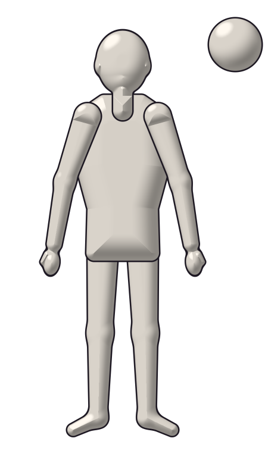
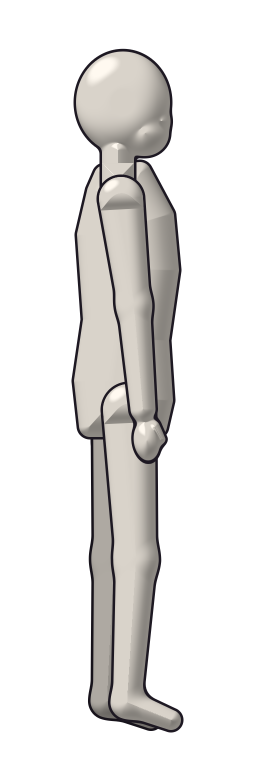

# Drawing a new character

Download `template.psd` and draw your character in the empty layers, over the grey figure.

<table>
  <tr>
    <td></td>
    <td></td>
  </tr>
  <tr>
    <td></td>
    <td align="center">Optional</td>
  </tr>
</table>

- Each layer is a body part, named after it. Layers are drawn in the order they're in the PSD.
- The side view is optional.
- The `ball` layer replaces the ball in the game. Optional too.
